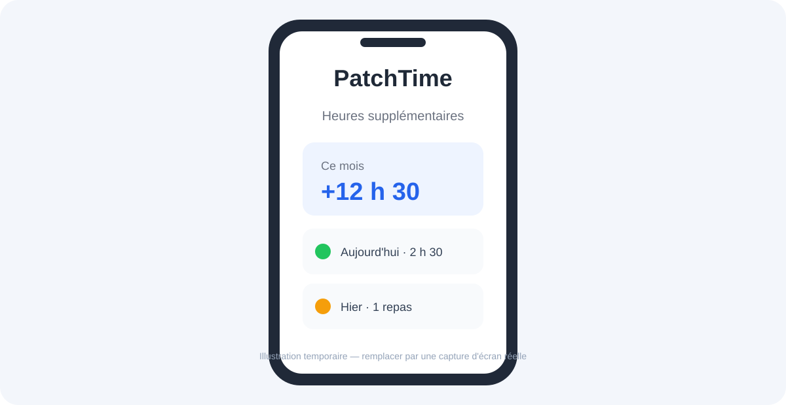

  

  

<h1 align="center">PatchTime</h1>

  
  
  
  
  
  

  

> The hero artwork is a placeholder. See the [screenshot checklist](.github/assets/screenshots/README.md) before preparing release or marketing images.

  <a href="#features">Features</a> ·
  <a href="#privacy">Privacy</a> ·
  <a href="#get-started">Get started</a> ·
  <a href="#architecture">Architecture</a> ·
  <a href="#status">Status</a> ·
  <a href="#the-patchbays-apps">The Patchbay's apps</a> ·
  <a href="#license">License</a>

## Features

PatchTime was formerly known as Suivi-Heure.

PatchTime is an iOS app for tracking overtime and professional meals, managing employers and leave, and preparing personal summaries.

- Record overtime and recovery time in 15-minute increments, including shifts that cross midnight.
- Track meals, employers, contracts, rate profiles, leave, and public holidays for France and Monaco.
- Review entries in a monthly calendar with configurable colors and local reminders.
- Explore statistics, employer comparisons, annual summaries, and indicative fiscal estimates.
- Export monthly PDF and CSV reports; save and restore data using JSON backups.
- Use home-screen, Lock Screen, and employer-specific widgets.
- Sync through the private CloudKit database associated with the user's iCloud account.

Tax, payroll, and expense figures are estimates for information only, not professional advice.

## Privacy

PatchTime has no app account or publisher-operated application server. App records are stored in Core Data and synchronized through the user's private CloudKit database. French public-holiday data is fetched from `calendrier.api.gouv.fr`. The app currently includes no advertising, analytics, or payment SDKs.

- [Privacy policy](https://patchbay-s.github.io/PatchTime/privacy/)
- [Terms of use](https://patchbay-s.github.io/PatchTime/terms/)
- [Support](https://patchbay-s.github.io/PatchTime/)

## Get started

[App Store](https://apps.apple.com/app/id6747032439). GitHub releases will contain the complete source code.

### Requirements

- Xcode 16 or later
- iOS 18.4 or later (iPhone and iPad)
- Swift 5.9 or later

### Build

1. Clone this repository and open `PatchTime.xcodeproj`.
2. Copy `Local.xcconfig.example` to `Local.xcconfig` and set `DEVELOPMENT_TEAM` if signing requires it. The local settings file is ignored by Git.
3. Select the `PatchTime` scheme and an iOS simulator or device.
4. Build and run in Xcode. Run the `PatchTimeTests` and `PatchTimeUITests` targets with Product → Test.

The App Store bundle identifier, CloudKit container, and App Group are existing production identifiers. Do not change them when configuring local signing.

## Architecture

PatchTime uses SwiftUI and Core Data with a lightweight MVVM structure. `CoreDataManager` owns the persistent CloudKit container; views use `@FetchRequest` for reactive reads and route mutations through the shared manager. Pure calculations are separated into model calculators and covered by unit tests.

| Area | Location |
|---|---|
| Core Data and CloudKit | [`PatchTime/Models/CoreDataManager.swift`](PatchTime/Models/CoreDataManager.swift) |
| App and tab navigation | [`PatchTime/Views/ContentView.swift`](PatchTime/Views/ContentView.swift) |
| Overtime entry and time ranges | [`PatchTime/Views/AddOvertimeView.swift`](PatchTime/Views/AddOvertimeView.swift), [`PatchTime/Models/OvertimeTimeRange.swift`](PatchTime/Models/OvertimeTimeRange.swift) |
| Calendar and widgets | [`PatchTime/Views/CalendarView.swift`](PatchTime/Views/CalendarView.swift), [`PatchTimeWidget/`](PatchTimeWidget/) |
| Fiscal and annual reports | [`PatchTime/Models/FiscalReportCalculator.swift`](PatchTime/Models/FiscalReportCalculator.swift), [`PatchTime/Models/AnnualReportCalculator.swift`](PatchTime/Models/AnnualReportCalculator.swift) |
| Export | [`PatchTime/Models/PDFGenerator.swift`](PatchTime/Models/PDFGenerator.swift), [`PatchTime/Models/CSVExporter.swift`](PatchTime/Models/CSVExporter.swift) |

## Status

Current app version: **5.0** (build **1**). No GitHub release has been published yet; follow the [releases page](https://github.com/Patchbay-s/PatchTime/releases) for source releases.

PatchTime is maintained as an open-source iOS project. Builds and static checks run through GitHub Actions. Confirm the support, privacy, and terms URLs in App Store Connect.

To report a reproducible issue or suggest a feature, use the [issue forms](https://github.com/Patchbay-s/PatchTime/issues/new/choose). Do not post personal work records or account details.

## The Patchbay's apps

| | App | Description |
|---|---|---|
|  | **PatchTime** — you are here | Overtime, meals, leave, and work summaries for iOS |
|  | [PatchNode](https://github.com/Patchbay-s/PatchNode) | iPhone, iPad and Mac dashboard for a homelab |
|  | [PatchProbe](https://github.com/Patchbay-s/PatchProbe) | Network scanner for macOS, Windows and Linux |

## License

PatchTime is licensed under [GPL-3.0-or-later with the App Store exception](LICENSE). Product names and logos are governed separately by [TRADEMARKS.md](TRADEMARKS.md).
